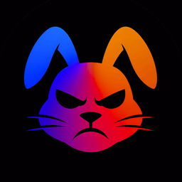
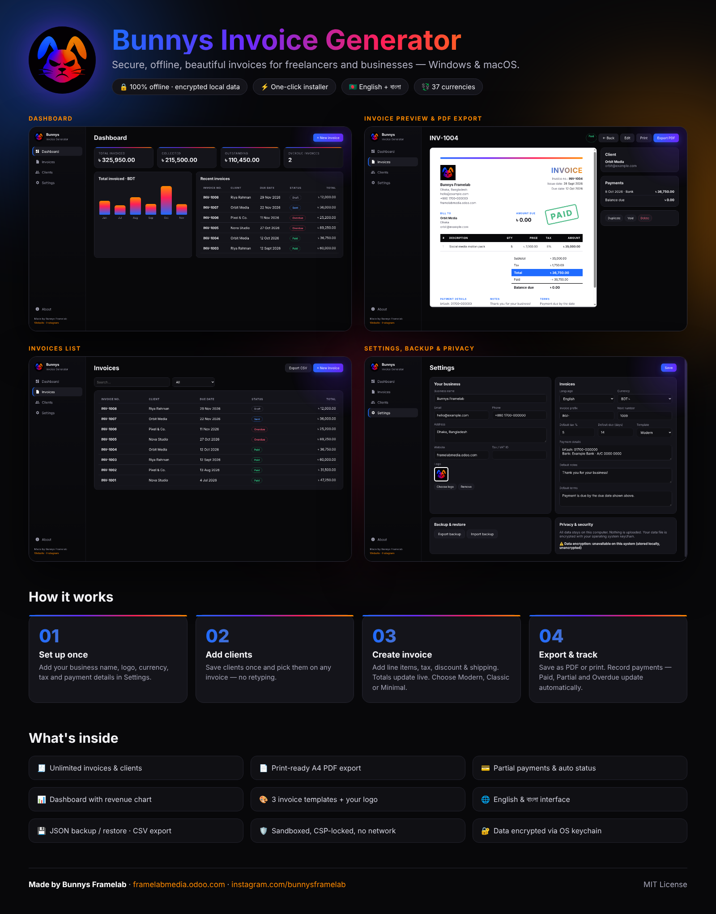

<div align="center">



# Bunnys Invoice Generator

**Secure, offline, beautiful invoices for freelancers, small businesses and big teams.**<br>
Windows &amp; macOS · One-click install · English + বাংলা · 37 currencies

[](../../releases/latest)
[](#-security--privacy)
[](LICENSE)
[](../../actions)



**Made by [Bunnys Framelab](https://framelabmedia.odoo.com/)** · [🌐 Website](https://framelabmedia.odoo.com/) · [📸 Instagram](https://www.instagram.com/bunnysframelab/)

</div>

---

## ✨ Who made this?
Bunnys Invoice Generator is built by **Bunnys Framelab** — a creative studio for visuals, motion and media. It is free and open source (MIT). The interface uses the Bunnys brand: **Electric Blue `#1F6BFF`**, **Sunset Orange `#FF8A00`**, **Deep Black `#08080A`**, with a Violet `#6A2BFF` → Hot Red `#FF1F56` gradient between them.

## 📥 Install (one click)
1. Open **[Releases → latest](../../releases/latest)**.
2. **Windows:** download `Bunnys-Invoice-Generator-Setup-x.y.z.exe` and run it. It installs in one step and opens the app.
3. **macOS:** download the `.dmg` (`arm64` for Apple Silicon M1–M4, `x64` for Intel). Open it and drag **Bunnys Invoice Generator** to *Applications*.

> **First-launch warning is normal.** The installers are not code-signed yet (certificates cost money), so the OS shows a caution screen.
> - **Windows SmartScreen:** *More info → Run anyway*.
> - **macOS:** right-click the app → *Open* → *Open*. If it says the app is damaged, run `xattr -cr "/Applications/Bunnys Invoice Generator.app"` once.
>
> Only download from this repository's Releases page.

## 🧭 How it works
| # | Step | What you do |
|---|---|---|
| 1 | **Set up once** | *Settings →* add business name, logo, currency (default BDT ৳), tax %, payment details, invoice prefix. |
| 2 | **Add clients** | *Clients →* save people once and pick them on any invoice. |
| 3 | **Create invoice** | *Invoices → New invoice.* Add line items, per-line tax, discount (fixed/%) and shipping. Totals update live. Pick **Modern / Classic / Minimal**. |
| 4 | **Send & track** | Save as *Sent*, **Export PDF** (A4) or **Print**. *Record payment* — status moves to **Partial / Paid**, and **Overdue** is detected automatically. |
| 5 | **Stay safe** | *Settings → Backup* exports/imports your data as JSON. *Invoices → Export CSV* for accounting. |

## 🧰 Features
- Unlimited invoices & clients, search & status filter, duplicate, void
- Partial payments, automatic Paid / Partial / Overdue status
- Dashboard: total invoiced, collected, outstanding, overdue, 6-month chart (multi-currency aware)
- 3 print-ready PDF templates with your logo; Bangla PDF supported
- English / বাংলা interface and invoice language
- 37 currencies with correct decimals (e.g. JPY has none); exact rounding (no floating-point drift)
- JSON backup/restore, CSV export, keyboard-accessible UI, reduced-motion support

## 🔒 Security & privacy
Your clients' data is yours: **no server, no account, no analytics, no network access at all.**
- Data stored locally, **encrypted with your OS keychain** (Windows DPAPI / macOS Keychain)
- Electron hardened: sandbox, context isolation, strict CSP, all network requests blocked, DevTools off, external links allow-listed
- Every IPC call is schema-validated in the main process; the renderer never touches the filesystem or Node
- No secrets or API keys exist in this project; `.env`/keys are git-ignored; Gitleaks + CodeQL + `npm audit` run in CI
- Details & reporting: [SECURITY.md](SECURITY.md)

## 🛠️ Build from source
```bash
git clone https://github.com/uday629/bunnys-invoice-generator.git
cd bunnys-invoice-generator
npm ci
npm start          # run the app
npm test           # unit tests
npm run dist:win   # Windows installer (run on Windows)
npm run dist:mac   # macOS dmg (run on a Mac)
```
Releases are built automatically by GitHub Actions on both Windows and macOS runners whenever a tag like `v1.0.0` is pushed.

## 🗂️ Project structure
```
src/main/      Electron main process (window, IPC, encrypted store, PDF)
src/renderer/  UI (vanilla JS, no framework, no runtime dependencies)
src/shared/    Money maths, validation schema, translations (shared + unit-tested)
test/          Unit tests (node:test)
scripts/       End-to-end smoke test (Playwright + Electron), screenshot tooling
docs/          README interface image (HTML source + PNG)
```

---
<div align="center">Made with 💙🧡 by <a href="https://framelabmedia.odoo.com/">Bunnys Framelab</a> · <a href="https://www.instagram.com/bunnysframelab/">@bunnysframelab</a></div>
